# 行政秘書工作流程圖與 AI 跟進規劃

> 資料來源：訪談逐字稿（2026-10-30）、《崔sir辦公室內部例行事情 2026.10.30 版》、《管理事項統整 2026.08.19》、《行政工作 SOP 2026.10.30》。
> 文件中所有帳號、密碼、PIN 碼一律**未**收錄於本文件，請改放密碼管理工具（見 6.9）。

## 0. 怎麼看這份文件

| 章節 | 內容 | 給誰用 |
|---|---|---|
| 1 | 工作全景圖：所有工作分類 | 主管、AI 應用師 |
| 2 | 一天 / 一週 / 一個月的時間節奏 | 秘書本人、代理人 |
| 3 | 各項工作的詳細流程圖（現況） | 系統開發、新人交接 |
| 4 | 案件行政程序（防綜 / 性能 / 紅白皮書） | 工程師、行政 |
| 5 | 痛點整理 | 主管 |
| 6 | 改善與 AI 導入建議（含改善後流程圖） | 主管、AI 應用師 |
| 7 | 導入路線圖與優先順序 | 全體 |
| 8 | AI 跟進任務總表 | AI 系統設定 |
| 9 | 待確認事項（文件之間不一致處） | 秘書、主管 |

圖例：**方框**＝動作，**菱形**＝判斷，**圓角**＝開始/結束，標 🤖 的步驟＝建議交給 AI 或系統自動化。

---

## 1. 工作全景圖

行政秘書的工作可以分成 8 大類、約 60 項。數量多、觸發來源分散（老闆、主管、工程師、會計、業務、外部單位、時鐘），這正是「事情太雜」的根源。

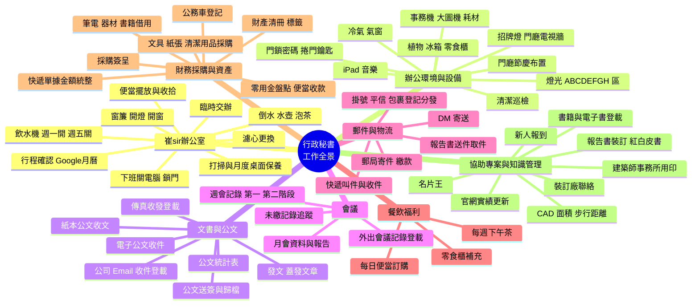

### 1.1 依「觸發來源」分類（這是之後導入 AI 的關鍵）

| 觸發來源 | 代表工作 | 目前接收方式 | 問題 |
|---|---|---|---|
| ⏰ 時鐘（固定時間） | 開燈、iPad、窗簾、訂便當、週會、月會、飲水機 | 自己記 / iPad 鬧鐘 | 靠記憶，容易漏 |
| 👔 崔sir | 交辦、倒水、辦公室事務 | 口頭 | 口頭交辦最容易忘 |
| 👩‍💼 林姐 / 主管 | 採購簽核、交辦 | 口頭 / LINE | 混在一起 |
| 👷 工程師 / 承辦 | 叫快遞、發文、裝訂、紅白皮書 | 口頭 / LINE | 打斷工作、無排序 |
| 💰 會計 | 快遞請款、郵資、勞保局信件 | 口頭 / 紙本 | — |
| 📮 外部（郵差、快遞、公文系統、傳真） | 收信、收文、電子公文 | 實體到件 / 上網查 | 需人工輪詢 |

---

## 2. 時間節奏

### 2.1 一天的流程（以週一為例）

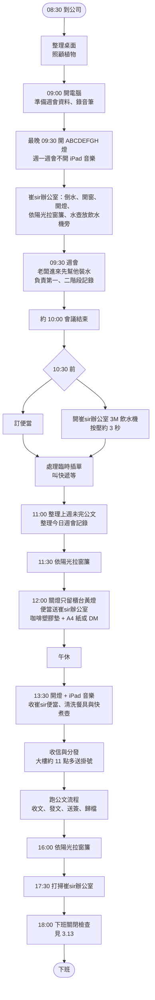

### 2.2 一週的節奏

```mermaid
flowchart LR
    subgraph MON["週一"]
      M1["09:30 週會<br/>列出超過 14 天未繳<br/>會議記錄、公文"]
      M2["報告公文收文統計<br/>與同仁差勤統計"]
      M3["週會後開飲水機"]
      M4["下午茶：選店、開投票、做表"]
      M5["辦公室整理與清潔巡檢"]
    end
    subgraph TUE["週二"]
      T1["約 16:30 下午茶下訂<br/>前一天先給店家確認"]
      T2["清潔大姐到班<br/>協助、巡視植物"]
    end
    subgraph WED["週三"]
      W1["下午茶送達"]
      W2["辦公室整理與清潔巡檢"]
    end
    subgraph THU["週四"]
      H1["Email 提醒工程師<br/>未繳會議記錄、未簽出公文<br/>再用 LINE 告知"]
      H2["辦公室整理與清潔巡檢"]
    end
    subgraph FRI["週五"]
      F1["清潔大姐到班"]
      F2["19:00 Tapo 自動關飲水機"]
      F3["抽屜零用金盤點<br/>便當收款"]
    end
    MON --> TUE --> WED --> THU --> FRI
```

> 崔sir辦公室與林姐辦公室：週一至週四由行政加強打掃；週二、週五由清潔大姐協助。

### 2.3 一個月的節奏

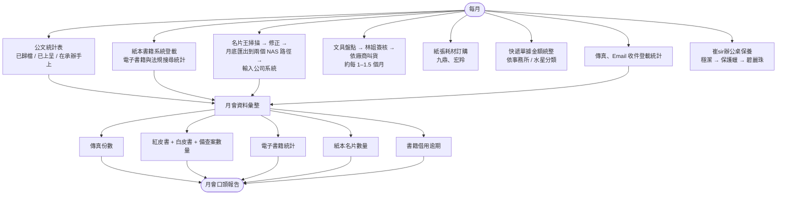

**月會報告固定說詞**（可直接讓 AI 套數字產生）：

> 傳真 □ 月份共 □ 份，已按照類別分送給各承辦人員。
> 公文清冊：內政部、基金會、建築中心各來 □ 份，尚未歸檔 □ 份，超過 14 天有 □ 份，並已通知承辦人員。

---

## 3. 各項工作詳細流程（現況）

### 3.1 週會（每週一 09:30）

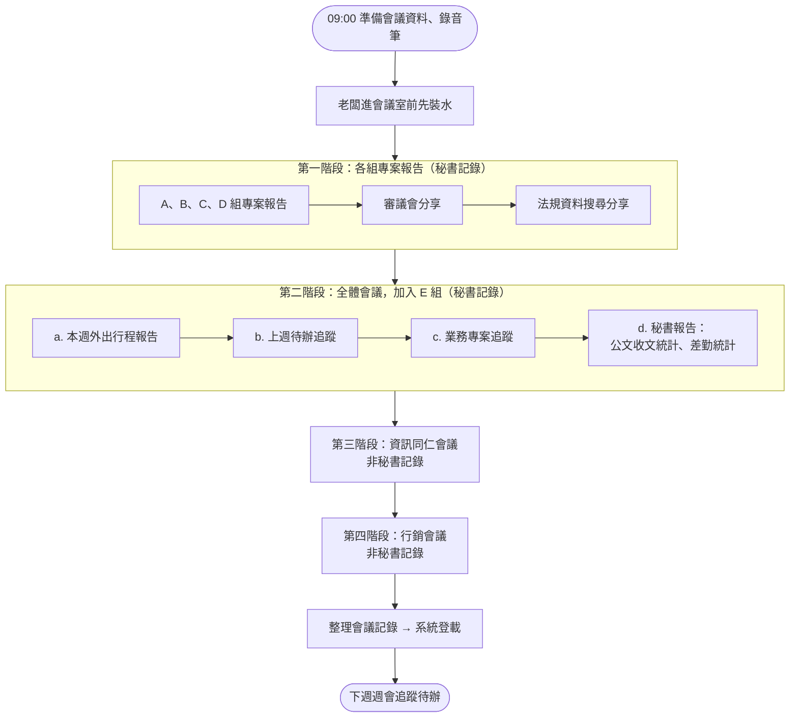

### 3.2 每日便當訂購

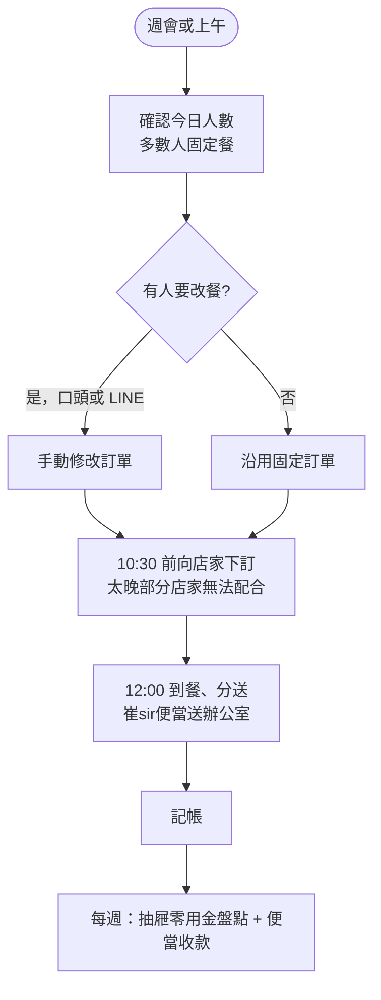

### 3.3 每週下午茶

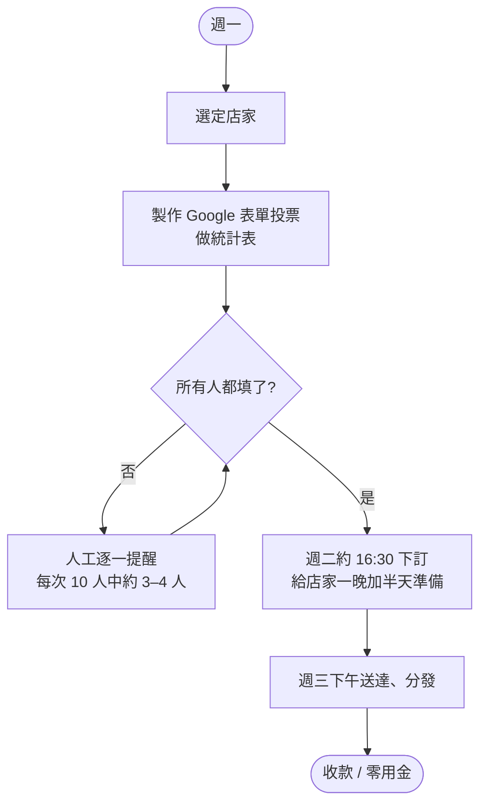

### 3.4 收信、掛號、包裹分發

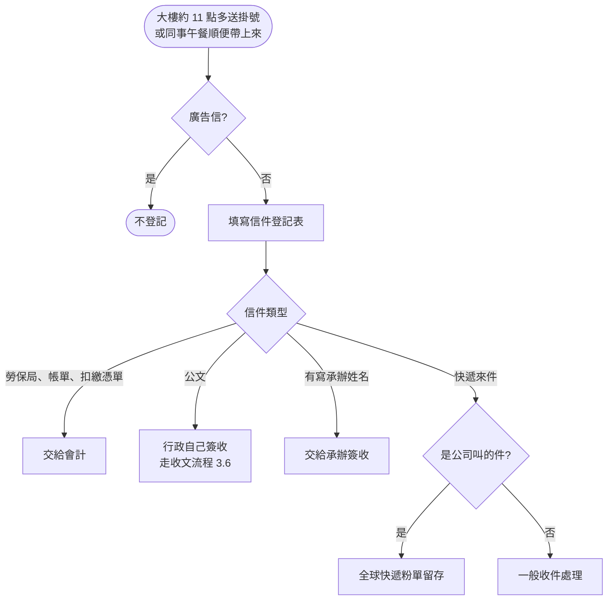

### 3.5 快遞叫件（全球快遞）

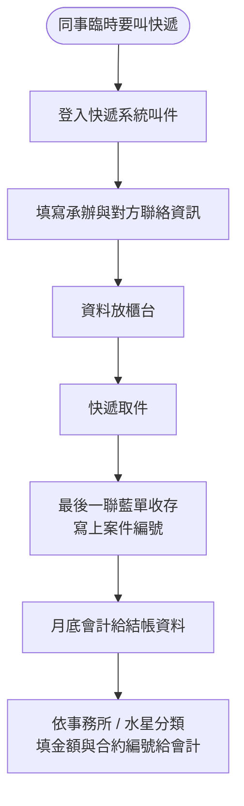

### 3.6 公文收文

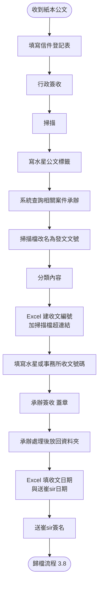

### 3.7 公文發文

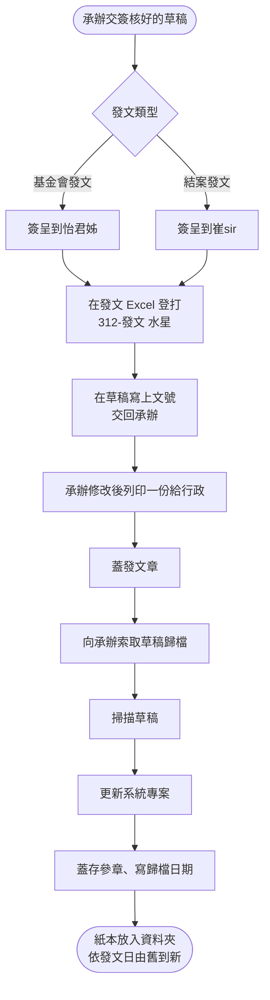

### 3.8 公文簽核後歸檔

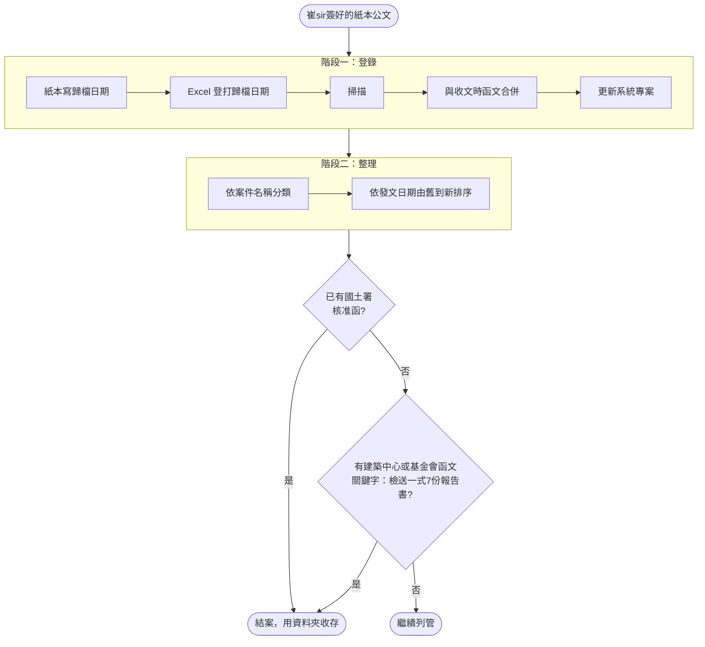

> 特殊狀況：副本查核案件的相關公文，只歸檔在原案件資料夾。
> 紙本整理頻率：預計每半年一次（暫定 2 月、8 月），下半年案量少時可提早。
> 紙本收文排序：依收文時間；分類為 ① 工程顧問、工程科技、消防開發、防災工程來文 ② 建築中心 ③ 基金會 ④ 國土署 ⑤ 消防局。發文以工程顧問為主，依序號、按年份存檔。

### 3.9 電子公文收件

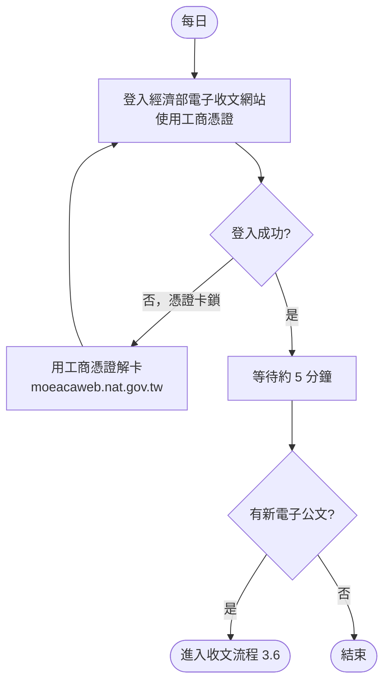

### 3.10 會議記錄（同仁外出開會）

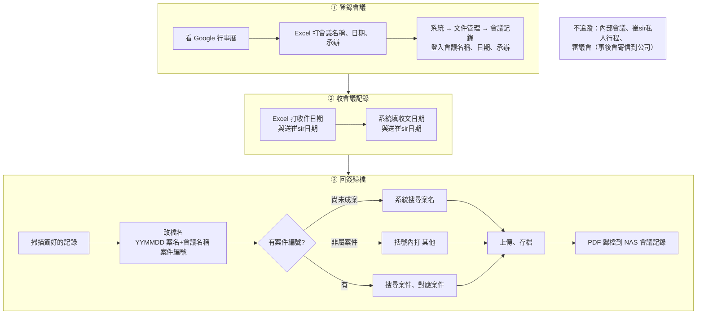

### 3.11 未繳追蹤與催繳

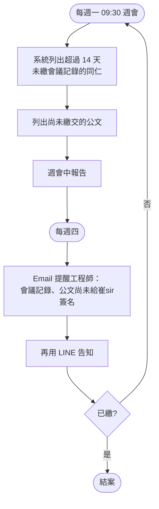

### 3.12 崔sir辦公室例行（2026.10.30 版）

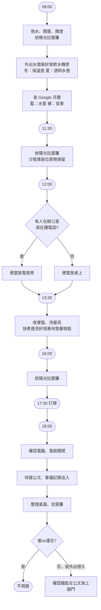

**打掃細節**

| 項目 | 頻率 | 方法 |
|---|---|---|
| 掃地 | 每天 | 從崔sir沙發椅後開始，由內往外 |
| 拖地 | 每週 | 同上，由內往外 |
| 倒垃圾 | 每天 | 崔sir與林姐辦公室 |
| 迎賓桌 | 視髒汙 | 撢子為主，必要時抹布，避免刮痕 |
| 辦公桌保養 | 每月 | 穩潔 → 保護蠟 → 碧麗珠，三條抹布分開（器具在 3M 飲水機下方） |
| 擺飾 | 定期 | 撢子，從水晶洞那排往門口順時鐘 |
| 沙發、椅子 | 定期 | 擦拭 |
| 電話 | 定期 | 酒精棉片（小儲藏室綠色小格抽屜） |
| 水晶洞 | 不定時 | 噴壺噴嬰兒油 |

**泡茶**：茶葉不超過濾水突起中心點；第一泡約 5 秒；之後裝水直接濾入杯中再裝滿；最多 6 泡就換新；茶葉不可泡在水裡（會苦澀），可先泡好放保溫壺。

### 3.13 辦公環境開關與下班檢查

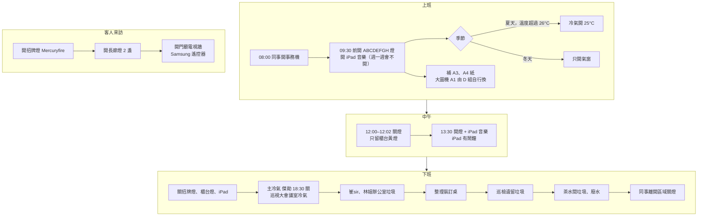

### 3.14 採購、零用金、郵寄

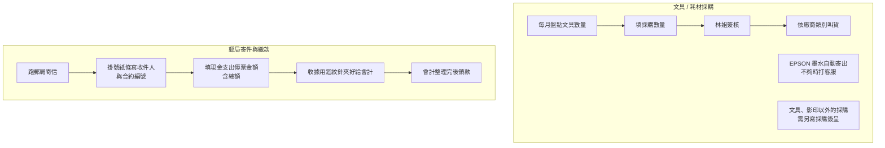

### 3.15 借用與登記

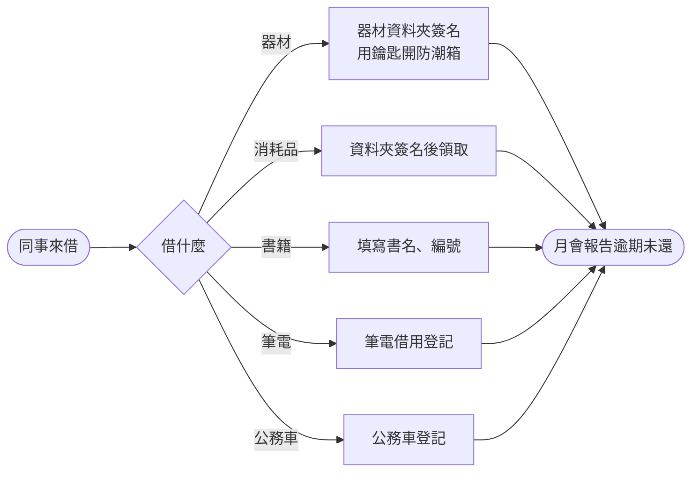

### 3.16 名片王與書籍登載

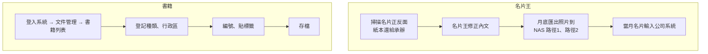

---

## 4. 案件行政程序（協助工程師）

### 4.1 防火避難綜合檢討（防綜案）

```mermaid
flowchart TD
    A(["案件申請"]) --> B["申請書用印<br/>承辦 → 案件主管 → 會計"]
    B --> C["初審掛件審查單位<br/>連同申請書"]
    C --> D["收到意見公文"]
    D --> E["回覆資料掛件"]
    E --> F{"需要開會?"}
    F -- 是 --> G["收到會議通知公文"] --> H["收到審議會會議記錄公文"]
    F -- 否 --> I
    H --> I["最終版報告書掛件"]
    I --> J["收到評定通過公文"]
    J --> K{"性能設計案?"}
    K -- "否（2019/11/4 起評定通過即可）" --> L(["進入紅白皮書"])
    K -- 是 --> M["收到國土署通過公文"] --> L
```

### 4.2 紅皮書 / 白皮書（使用執照前 = 紅，使用執照後 = 白）

```mermaid
flowchart TD
    A(["案件通過"]) --> T{"案件類型"}
    T -- "防綜案 共 7 本" --> P1
    T -- "性能案 共 8 本" --> Q1["承辦先請裝訂廠做一份<br/>郵寄內政部營建署"]
    Q1 --> Q2["內政部認可申請書函文<br/>平信寄到公司，請留意"]
    Q2 --> P2
    P1["評定單位認可申請書函文"] --> P2["承辦列印摘要"]
    P2 --> P3["行政抽換正本頁<br/>見 4.3"]
    P3 --> P4["通知裝訂廠"]
    P4 --> P5["完成後送評定單位用印"]
    P5 --> P6{"性能案?"}
    P6 -- 是 --> P7["國土署用印<br/>國土署收 3 本"]
    P6 -- 否 --> P8["評定單位收 3 本"]
    P7 & P8 --> P9["水星留存 1 本歸檔"]
    P9 --> P10(["建築師事務所 + 業主共 3 本"])
```

### 4.3 紅白皮書製作細節（行政負責段）

```mermaid
flowchart TD
    A(["承辦印好摘要<br/>通常 7 份，特殊 8 份"]) --> B["準備正本：<br/>① 委員同意書簽名<br/>② 第二章最後一頁建築師法規簽名 + 大小章<br/>③ 公司聲明書"]
    B --> C["每份抽換建築師法規簽名頁"]
    C --> D["其中一份另換委員同意書<br/>與公司聲明書正本<br/>貼便條紙備註"]
    D --> E{"評定單位"}
    E -- 基金會 --> E1["第二章法規檢討表建築師簽名 1 份正本<br/>其餘彩印<br/>建築圖說：不用蓋章簽名"]
    E -- 建築中心 --> E2["第二章法規檢討表建築師簽名 1 份正本<br/>其餘彩印<br/>建築圖說：建築師蓋章"]
    E1 & E2 --> F["向承辦索取封面、書背 PDF<br/>部分裝訂廠要 Word"]
    F --> G["寄給裝訂廠"]
    G --> H["電話確認收到、確認時程"]
    H --> I(["之後請裝訂廠直接與承辦聯繫"])
```

> 使用執照後變更的白皮書，需另外找建築師簽名位置。
> 消防圖 A1 折法另有步驟說明（大小章需露出）。

---

## 5. 痛點整理

| # | 痛點 | 現況證據 | 影響 |
|---|---|---|---|
| P1 | **任務入口太多**：口頭、LINE、紙條、時鐘、外部到件 | 「我現在最大的問題就是事情太雜了」 | 分心、無法排序 |
| P2 | **口頭交辦容易忘** | 老闆交代整理儲藏室紙袋，做完前一件就忘了 | 漏辦、影響老闆信任 |
| P3 | **臨時插單打斷** | 訂完餐後同事臨時叫快遞，「莫名其妙就 11:00」 | 上午時段被切碎 |
| P4 | **人工催繳耗時** | 下午茶每次 3–4 人要人工確認；會議記錄、公文每週 email + LINE 催 | 重複勞動 |
| P5 | **同一筆資料重複登打** | 公文同時寫在登記表、Excel、系統、紙本標籤；會議記錄同時 Excel + 系統 | 易出錯、耗時 |
| P6 | **定時瑣事靠記憶** | 燈、iPad、窗簾 11:30 / 16:00、飲水機週一開 | 心力被佔用 |
| P7 | **月報要手動統計** | 傳真、公文、名片、書籍、紅白皮書數量 | 月底壓力 |
| P8 | **知識只在一個人腦中** | 泡茶、窗簾、折圖、紅白皮書抽換正本 | 請假時無人能代理 |
| P9 | **密碼明文寫在 SOP** | 舊系統、電子公文、工商憑證 PIN、快遞帳號都寫在 Word | 資安風險 |
| P10 | **公文追蹤不透明** | 要翻 Excel 才知道公文在誰手上 | 逾期才發現 |

---

## 6. 改善與 AI 導入建議

**原則**（來自訪談）：
1. 一次解決一個問題，逐步擴充，不求一次到位。
2. 系統配合人的習慣，不是人去習慣系統。
3. 秘書喜歡「消紅點」：所有事變成一張可勾選的待辦清單。

### 6.1 核心：統一任務入口（LINE 官方帳號 → 待辦清單）

把 P1、P2、P3 一次處理掉。所有找秘書的事都進同一個入口，自動變成待辦。

```mermaid
flowchart LR
    subgraph IN["任務來源"]
      i1["同事在 LINE 官方帳號<br/>按按鈕提出需求"]
      i2["崔sir口頭交辦<br/>秘書手機語音一句話"]
      i3["⏰ 排程<br/>每日、每週、每月例行"]
      i4["📮 外部到件<br/>信件、電子公文、傳真"]
    end
    IN --> AI["🤖 AI 整理<br/>分類、判斷急迫性、<br/>估時間、補齊欄位"]
    AI --> TODO["秘書待辦清單<br/>手機行事曆同步"]
    TODO --> D{"完成?"}
    D -- 是 --> OK["勾掉，消紅點<br/>🤖 自動回覆提出人：已完成"]
    D -- 逾時 --> R["🤖 提醒秘書<br/>崔sir交辦優先"]
    R --> TODO
```

**LINE 官方帳號建議選單**

| 按鈕 | 填寫欄位 | 進待辦後的動作 |
|---|---|---|
| 叫快遞 | 收件方、地址電話、案件編號、時間 | 🤖 預填快遞單資料；完成後回覆追蹤碼 |
| 寄掛號 / 郵件 | 收件方、合約編號 | 合併到當天下午跑郵局 |
| 裝訂 / 紅白皮書 | 案號、份數、評定單位、交件日 | 🤖 自動產生 4.3 的正本抽換清單 |
| 借用 | 物品、歸還日 | 到期前一天 🤖 提醒借用人 |
| 便當改餐 | 今天要換成 … / 今天不吃 | 寫入當日訂單 |
| 其他交辦 | 自由文字 | 🤖 判斷分類 |

### 6.2 便當訂購（改善後）

```mermaid
flowchart TD
    A(["每天 09:00 🤖 自動建立今日訂單<br/>預設沿用上次"]) --> B["同事要改：LINE 按鈕修改<br/>不改不用動作"]
    B --> C["10:15 🤖 截止並彙總<br/>品項、數量、金額"]
    C --> D["秘書確認後下訂<br/>或 🤖 直接傳給店家"]
    D --> E["🤖 自動記帳，每人累計應付"]
    E --> F(["週五 🤖 產生收款明細<br/>對零用金"])
```

### 6.3 下午茶（改善後）

```mermaid
flowchart TD
    A(["週一上午 秘書選店"]) --> B["🤖 LINE 推播投票連結"]
    B --> C{"截止前<br/>週二 15:00"}
    C -- 未填 --> D["🤖 自動提醒<br/>間隔可調，例如每 2 小時<br/>截止前 1 小時加強"]
    D --> C
    C -- 全部完成 --> F
    C -- "截止仍未填" --> E{"規則<br/>由主管決定"}
    E -- "預設：不點" --> F
    E -- "沿用上次品項" --> F
    E -- "只通知秘書名單" --> F
    F["🤖 自動彙總訂單表"] --> G["週二 16:30 秘書下訂"]
    G --> H(["週三送達 🤖 推播取餐通知"])
```

> 訪談預估：需人工追的人數從每次 3–4 人降到 1 人以下，只剩「已讀不點」的人。逾時規則屬於主管權限，建議先由主管拍板。

### 6.4 公文電子化與追蹤（新系統）

依訪談中的四個想法設計：掃描線上分發、本人簽收、不設代理、依類別自動推進。

```mermaid
flowchart TD
    A(["紙本或電子公文進來"]) --> B["掃描"]
    B --> C["🤖 OCR 讀取<br/>發文機關、文號、日期、主旨"]
    C --> D["🤖 比對案件<br/>建議承辦、建議類別"]
    D --> E["秘書確認類別<br/>一鍵送出"]
    E --> F["系統依類別路由<br/>例：A 簽收 → B 執行 → C 簽核 → D 主管審核"]
    F --> G["承辦用工號 + 密碼登入簽收<br/>確保本人"]
    G --> H{"期限內簽收?"}
    H -- 否 --> I["🤖 自動提醒<br/>第 3、7、14 天升級"]
    I --> J{"請假中?"}
    J -- 是 --> K["不轉代理人<br/>銷假後提醒"]
    J -- 否 --> G
    H -- 是 --> L["推進到下一關"]
    L --> M{"最後一關?"}
    M -- 否 --> G
    M -- 是 --> N["🤖 自動歸檔<br/>檔名、案件、NAS 路徑"]
    N --> O(["後台總表即時顯示<br/>每件公文在哪一關"])
```

這張圖同時取代：信件登記表 + Excel 收文表 + 系統登錄 + 紙本簽收 + 週一列印未繳清單 + 週四 email 催繳（解決 P5、P10）。

### 6.5 會議記錄（週會與外出會議）

```mermaid
flowchart TD
    A(["會議中錄音"]) --> B["🤖 語音轉逐字稿"]
    B --> C["🤖 依五階段格式整理摘要<br/>只產出第一、二階段"]
    C --> D["🤖 抽出待辦：誰、做什麼、期限"]
    D --> E["秘書校對"]
    E --> F["發佈到系統"]
    F --> G["🤖 待辦自動進各人清單"]
    G --> H(["下週週會 🤖 自動產生<br/>上週待辦追蹤表"])
    X(["外出會議：Google 行事曆"]) --> Y["🤖 自動建立會議記錄登錄<br/>不用手打 Excel"]
    Y --> Z["🤖 會後 7 天、14 天自動催繳"]
```

### 6.6 定時瑣事：交給設備排程與提醒

| 工作 | 目前 | 建議 |
|---|---|---|
| 辦公室燈 09:30 / 12:00 / 13:30 | 手動 | 智慧開關排程（類似現在飲水機用的 Tapo） |
| iPad 音樂 | 手動 + 鬧鐘 | 捷徑自動化，週一自動跳過 |
| 招牌燈 | 每天手動 | 智慧插座排程；下班自動關 |
| 崔sir窗簾 11:30 / 16:00 | 手動看陽光 | 先用 🤖 手機提醒；長期可評估電動窗簾 |
| 飲水機週一開 | 手動按 3 秒 | Tapo 加一條週一 08:00 開（需確認按壓式是否支援斷電復電自動開） |
| 冷氣 26°C 規則 | 看溫度表 | 溫濕度計 + 🤖 超過 26°C 推播 |
| 冰箱清理 | 不定時 | 🤖 每週五推播全體 |

### 6.7 月會報表自動化

```mermaid
flowchart LR
    A["公文系統"] --> R
    B["傳真登錄"] --> R
    C["名片系統"] --> R
    D["書籍借用"] --> R
    E["紅白皮書案件"] --> R
    R["🤖 月底自動統計"] --> S["🤖 套入月會說詞範本"]
    S --> T(["秘書看過即可報告"])
```

### 6.8 知識傳承：把一人知識變成 AI 可問的手冊

- 把本文件 + 崔sir辦公室例行 + SOP 放進 AI 知識庫，代理人可直接問：「崔sir的茶怎麼泡？」「性能案紅皮書要幾本？」「基金會的建築圖說要不要蓋章？」
- 「崔sir交辦事項」互相代理人（嘉緯哥）也能透過同一個待辦清單看到進度。

### 6.9 資安

- SOP 中列出的系統帳密、電子公文帳密、工商憑證 PIN、快遞帳號、門鎖密碼，應**全部移出文件**，改存公司密碼管理工具（例如 Bitwarden 企業版），依角色授權。
- 移出後建議更改一次密碼，因為舊文件可能已被複製流傳。
- 公文 Excel 的保護密碼與筆電密碼相同，建議分開。

---

## 7. 導入路線圖

依「痛的程度 × 容易做」排序，一次一項，做完再加下一項。

```mermaid
flowchart LR
    subgraph PH1["第一階段 1–2 週：先止痛"]
      a1["LINE 官方帳號任務入口"]
      a2["待辦清單 + 手機行事曆"]
      a3["口頭交辦語音轉待辦"]
      a4["密碼移出 SOP"]
    end
    subgraph PH2["第二階段 3–4 週：去掉重複催"]
      b1["下午茶投票 + 自動催填"]
      b2["便當預設沿用 + 改餐按鈕"]
      b3["會議記錄 14 天自動催繳"]
      b4["定時提醒：窗簾、冰箱"]
    end
    subgraph PH3["第三階段 1–2 個月：公文上線"]
      c1["掃描 + OCR + 比對案件"]
      c2["本人簽收 + 未簽提醒"]
      c3["依類別多關卡流程"]
      c4["後台總表"]
    end
    subgraph PH4["第四階段：持續優化"]
      d1["月會報表自動化"]
      d2["週會錄音轉記錄"]
      d3["智慧插座排程"]
      d4["AI 知識庫給代理人"]
    end
    PH1 --> PH2 --> PH3 --> PH4
```

| 階段 | 項目 | 解決痛點 | 預估效益 |
|---|---|---|---|
| 1 | 統一任務入口 | P1 P2 P3 | 不再漏事；被打斷次數大幅下降 |
| 1 | 密碼移出 | P9 | 降低資安風險 |
| 2 | 下午茶 / 便當 / 催繳自動化 | P4 | 每週省下人工追人時間 |
| 3 | 公文電子流程 | P5 P10 | 一筆資料只輸入一次；逾期即時可見 |
| 4 | 月報、會議記錄、設備、知識庫 | P6 P7 P8 | 月底不再趕報表；可代理 |

---

## 8. AI 跟進任務總表

給 AI / 自動化系統設定用。每一列是一條「觸發 → 動作」規則。

| 類別 | 任務 | 觸發 | AI / 系統動作 | 通知對象與管道 |
|---|---|---|---|---|
| 每日 | 開燈、iPad 音樂 | 平日 09:25 | 提醒；週一註明「週會不開音樂」 | 秘書 / 手機 |
| 每日 | 崔sir辦公室早上準備 | 平日 08:55 | 推送檢查清單：倒水、開窗、開燈、窗簾、水壺、行程 | 秘書 / 手機 |
| 每日 | 便當開單 | 平日 09:00 | 建立訂單，預設沿用上次 | 全體 / LINE 官方帳號 |
| 每日 | 便當截止 | 平日 10:15 | 彙總訂單 | 秘書 / LINE |
| 每日 | 拉窗簾 | 平日 11:30、16:00 | 提醒依陽光調整 | 秘書 / 手機 |
| 每日 | 中午關燈 | 平日 12:00 | 提醒或智慧開關 | 秘書 / 手機 |
| 每日 | 便當送崔sir | 平日 12:00 | 提醒：咖啡墊 + A4 紙或 DM | 秘書 / 手機 |
| 每日 | 午後開燈 + 收便當 | 平日 13:30 | 提醒 | 秘書 / 手機 |
| 每日 | 收信分發 | 平日 13:30 | 提醒；登記表改成拍照 🤖 辨識 | 秘書 / 手機 |
| 每日 | 電子公文 | 平日 14:00 | 提醒登入查收 | 秘書 / 手機 |
| 每日 | 崔sir辦公室打掃 | 平日 17:30 | 推送打掃清單 | 秘書 / 手機 |
| 每日 | 下班檢查 | 平日 17:50 | 推送下班檢查清單（3.13） | 秘書 / 手機 |
| 每週一 | 週會準備 | 08:50 | 🤖 產生上週待辦追蹤表、公文統計、差勤統計 | 秘書 |
| 每週一 | 未繳清單 | 09:00 | 🤖 列出超過 14 天未繳會議記錄、公文 | 秘書；週會報告 |
| 每週一 | 飲水機 | 週會後 10:05 | 提醒開 3M 飲水機 | 秘書 |
| 每週一 | 下午茶投票 | 秘書選店後 | 推播投票 | 全體 / LINE |
| 每週二 | 下午茶催填 | 截止前每 2 小時 | 只發給未填者 | 未填者 / LINE |
| 每週二 | 下午茶下訂 | 16:00 | 彙總 + 提醒 16:30 下訂 | 秘書 |
| 每週四 | 催繳會議記錄、公文 | 09:00 | 🤖 個別 Email + LINE 給未繳工程師 | 工程師 |
| 每週五 | 零用金與便當收款 | 15:00 | 🤖 產生收款明細 | 秘書 |
| 每週五 | 冰箱清理 | 16:00 | 提醒全體 | 全體 / LINE |
| 每週五 | 飲水機 | 長假前 | 提醒詢問崔sir是否進公司再關電源 | 秘書 |
| 每月 | 崔sir辦公桌保養 | 每月第一個週一 | 提醒穩潔 → 保護蠟 → 碧麗珠 | 秘書 |
| 每月 | 文具盤點 | 每月 1 日 | 盤點清單 → 林姐簽核 | 秘書、林姐 |
| 每月 | 名片王匯出 | 月底前 3 天 | 提醒匯出兩個路徑並輸入系統 | 秘書 |
| 每月 | 快遞單據統整 | 會計給結帳資料時 | 🤖 依藍單案件編號分類加總 | 秘書、會計 |
| 每月 | 月會資料 | 月會前 3 天 | 🤖 統計五項數字並套入說詞 | 秘書 |
| 每月 | 書籍逾期 | 月會前 3 天 | 🤖 列出逾期未還並通知借用人 | 借用人 |
| 每年 | 清潔用品大盤點 | 年前大掃除前 | 提醒 | 秘書 |
| 每年 | 門廳布置 | 12 月初、春節前 3 週 | 提醒聖誕、春節布置 | 秘書 |
| 每半年 | 紙本公文整理 | 2 月、8 月 | 提醒整理成冊 | 秘書 |
| 事件 | 崔sir交辦 | 交辦當下 | 語音轉待辦，標最高優先；逾時提醒並通知代理人嘉緯哥 | 秘書、代理人 |
| 事件 | 客人來訪 | 行事曆有訪客 | 提前 15 分鐘提醒開招牌燈、長廊燈、電視牆 | 秘書 |
| 事件 | 公文未簽收 | 送出後 3 / 7 / 14 天 | 升級提醒 | 承辦 → 主管 |
| 事件 | 借用到期 | 到期前 1 天 | 提醒歸還 | 借用人 |
| 事件 | 紅白皮書 | 收到評定通過公文 | 🤖 產生該案正本抽換清單與份數分配 | 承辦、秘書 |
| 事件 | 寄送裝訂廠後 | 寄出當天 | 提醒打電話確認收件與時程 | 秘書 |
| 事件 | 新人報到 | 人事通知 | 推送報到清單：電腦擺設、門鎖、帳號 | 秘書、E 組 |

---

## 9. 待確認事項

整理時發現以下幾處文件與訪談說法不一致，建議和主管確認後統一：

1. **下午茶時間**：SOP 寫「每週三下午三點訂下午茶」；訪談說「週一投票、週二 16:30 下訂、週三送達」。以訪談為準？
2. **招牌燈**：工作表列在「每日」；SOP 寫「客人來訪才開」。每天開還是只有客人來才開？
3. **代理人**：工作表寫崔sir交辦事項「互相為代理人」；訪談希望公文簽收「不設代理人」。建議：公文簽收不代理，崔sir交辦可代理。
4. **水壺顏色**：一份寫「冬天黑色保溫壺」，另一份寫「白色保溫杯水壺」。
5. **會議記錄與公文系統**：SOP 註明「新系統修正中，待討論」，目前是 Excel 與系統並行。何時停用 Excel？
6. **下午茶逾時規則**：超過時間未點，是不點、沿用上次，還是只通知？需主管決定。
7. **飲水機電源**：目前寫「暫時先不關閉電源」，但 Tapo 已設週五 19:00 關閉，兩者衝突。
8. **財產清冊**：AB 類由 E 組登記、CD 類由行政登記，分類標準在哪裡？
