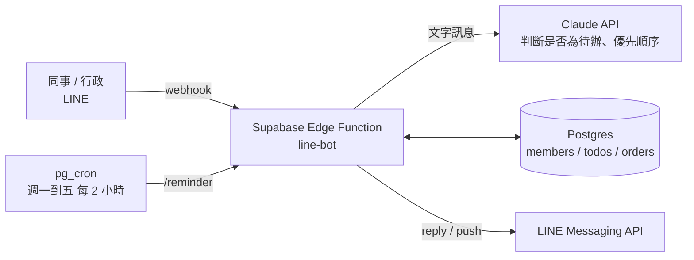

# LINE 官方帳號機器人：設定與使用

LINE 官方帳號 Channel ID：`2012305336`
後端：Supabase 專案「Work」（`onzqllxxfzwaghbewphi`，東京）
Webhook URL：`https://onzqllxxfzwaghbewphi.supabase.co/functions/v1/line-bot`

## 功能

| 功能 | 誰用 | 怎麼用 |
|---|---|---|
| 建立待辦 | 行政 | 傳「新增 內容」，AI 判斷 緊急／重要／其他；也可直接指定：「新增 緊急 下午三點前寄掛號」 |
| 待辦清單 | 行政 | 傳「待辦」，依 緊急／重要／其他 分三張卡，每件都有「完成」按鈕 |
| 定時提醒 | 行政 | 週一到週五 9、11、13、15、17 點（台北時間）自動推播未完成待辦；沒有待辦就不推 |
| 同事需求自動轉交 | 同事 → 行政 | 同事直接打字（例如「明天幫我叫快遞寄報告書」），AI 整理成待辦並推播給行政；行政按「完成」後會通知提出的同事 |
| 訂便當 | 同事 | 按「訂便當」出現卡片，可選品項、「照舊」或「今天不訂」；沒選的人統計時自動沿用上次 |
| 點下午茶 | 同事 | 按「點下午茶」出現本週品項卡片 |
| 訂餐統計 | 行政 | 「便當統計」「下午茶統計」「截止下午茶」「催下午茶」 |
| 菜單設定 | 行政 | 「設定便當 雞腿飯 90／排骨飯 85／素食 80」、「設定下午茶 店名｜珍奶 60／紅茶拿鐵 55」 |

## 第一次設定（約 15 分鐘）

### 1. 在 LINE Developers 取得兩個金鑰

登入 <https://developers.line.biz/console/> → 找到 Channel ID `2012305336`：

- **Basic settings** 分頁 → `Channel secret`
- **Messaging API** 分頁 → 最下面 `Channel access token (long-lived)` → Issue

### 2. 取得 Claude API 金鑰

<https://console.anthropic.com/> → API Keys → Create Key。

### 3. 把金鑰填進 Supabase

Supabase Dashboard → 專案 Work → Edge Functions → **Secrets**，新增四個：

| 名稱 | 值 |
|---|---|
| `LINE_CHANNEL_SECRET` | 步驟 1 的 Channel secret |
| `LINE_CHANNEL_ACCESS_TOKEN` | 步驟 1 的 Channel access token |
| `ANTHROPIC_API_KEY` | 步驟 2 的金鑰 |
| `OWNER_BIND_CODE` | 自己設一組綁定碼，例如一串隨機英數字，用來把你的 LINE 綁成「行政主帳號」 |

### 4. 設定 Webhook

LINE Developers → Messaging API 分頁：

1. Webhook URL 填 `https://onzqllxxfzwaghbewphi.supabase.co/functions/v1/line-bot` → Update → Verify（應顯示 Success）
2. 打開 **Use webhook**
3. 到 LINE Official Account Manager → 回應設定：**關閉「自動回應訊息」**，否則會跟機器人重複回覆

### 5. 綁定你的主帳號

用你自己的 LINE 加官方帳號好友，傳：

```
綁定 你設定的OWNER_BIND_CODE
```

收到「已綁定為行政主帳號」就完成。之後所有提醒和同事需求都會推播給這個帳號。

### 6.（建議）設定圖文選單

LINE Official Account Manager → 圖文選單 → 建立，選 3 格版型，動作都選「文字」：

| 區塊 | 文字 |
|---|---|
| A | 訂便當 |
| B | 點下午茶 |
| C | 說明 |

同事打開聊天室底部就有按鈕。

## 費用與限制

- **LINE 推播額度**：回覆訊息免費；「推播」會算額度。輕用量方案每月約 200 則。本系統會推播的情況：定時提醒（最多每天 5 則）、同事需求通知行政、完成後通知同事、「催下午茶」。若額度不夠，可升級方案或把提醒改成每天較少次。
- **Claude API**：只有「不是指令的文字訊息」才會呼叫 AI，一則約新台幣幾毛錢以內。
- **國定假日**：排程只看星期一到五，假日照樣提醒；需要的話可再加假日表。

## 架構



程式碼：`supabase/functions/line-bot/`，資料表：`supabase/migrations/`。
